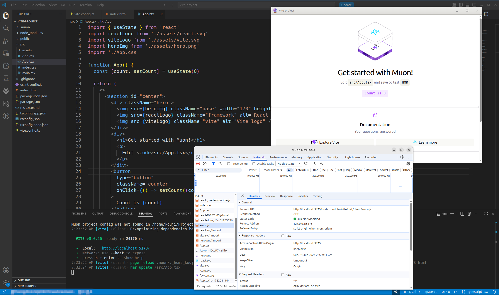
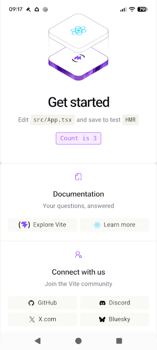
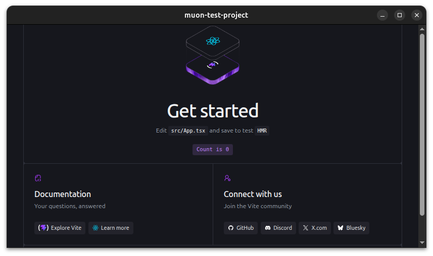
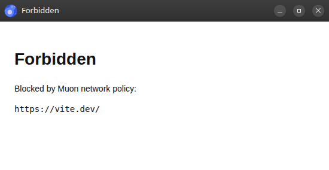
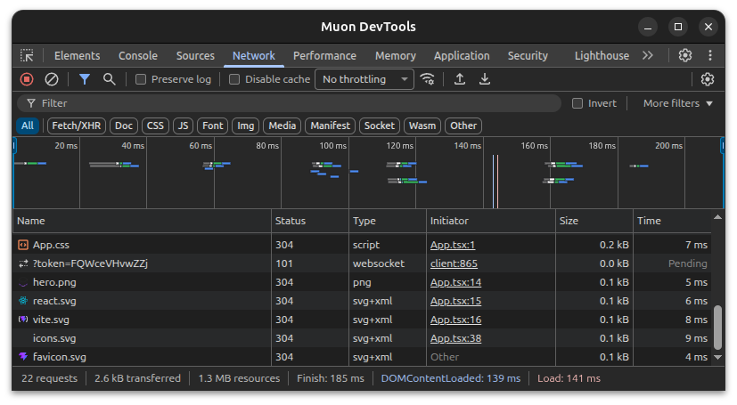

# muon

A multi-platform framework for building GUI applications with web technologies.


[](https://www.repostatus.org/#wip)
[](https://opensource.org/licenses/MIT)
[](https://www.npmjs.com/package/muon-ui)

---

[(For Japanese language/日本語はこちら)](./README_ja.md)

> Please note that this English version of the document was machine-translated and then partially edited, so it may contain inaccuracies.
> We welcome pull requests to correct any errors in the text.

## What is this?

Have you ever wanted to update an aging native GUI application into a modern application?
Application replacement is extremely complex, and it has always been a hard problem.

The causes vary widely, so there is no magic solution that makes everything easy.
Even so, everyone wants to modernize with as little cost as possible.

muon (/ˈmjuːɒn/) is a multi-platform GUI application framework that uses CEF (Chromium Embedded Framework) on Linux and Windows and WebView on Android.
You have probably heard of similar projects such as [Electron](https://www.electronjs.org/).

Roughly speaking, muon is framework software in the same category.
In other words, it lets you implement local GUI applications as web applications.

With muon, you can build native applications using the most mature and widely used browser UI frameworks, such as React and Vue.



So how is muon different from earlier framework software?

muon specializes in local GUI application development.
On desktop, muon controls access to external web resources with an allowlist.

You may think that using CEF without access to websites around the world is a waste.
However, we believe that this is the biggest reason existing solutions have become very complex and difficult to handle.

> On Android, WebView network access follows Android permissions and the app's network security configuration. See [Android WebView limitations](./docs/en/limitation.md#android-webview-backend).

muon also includes a plugin system with fully asynchronous processing for interoperability with native libraries.
These features are enabled from explicit configuration, so unused capabilities are not left open.

Support for features such as WebGL, WebGPU, WebAssembly, Web Workers, and local storage depends on the CEF or WebView version and its settings.
Desktop apps can show DevTools. CDP (Chrome DevTools Protocol) is also available, so you can debug with VS Code, connect Playwright, or control the app externally.
You can also use remote DevTools from Chromium/Chrome through `chrome://inspect/`.

In short, muon clearly removes one of the major problems that appears when migrating GTK/Qt/Windows native applications to web applications.
This lets you build modern local GUI applications with the web technology ecosystem.

muon also minimizes the steps required to create a muon application, keeping the barrier to entry low.
With the minimal desktop setup, installing the NPM package and adding one line to the configuration file is enough to launch your first muon app.

You can deploy muon applications to Linux, Windows, and Android.



> Note: Android builds are still experimental, and we are working toward completion.

muon can generate deb packages, AppImages, or tarballs for Linux, and Nullsoft Scriptable Install System (NSIS) installers or ZIP files for Windows.

### Features

- Desktop apps can restrict access to external web resources with an allowlist.
- Provided as an easy-to-use NPM package, so you can turn your web application project into a native GUI application without complex configuration or changes.
- Uses CEF for rendering on Linux and Windows and WebView on Android.
- Supports Vite plugins. On desktop, Vite HMR updates the preview in real time during development.
- Supports Linux (deb and AppImage) and Windows (NSIS) package generation, and portable distribution.
- You can also build Android applications (Experimental).
- Desktop apps can show DevTools and support remote debugging over CDP.
- Includes a plugin system. Plugin capabilities can also be restricted by a whitelist filter.
- An independent SDK supports C/C++ plugin development and distribution as prebuilt NPM packages.
- Built-in plugins provide access to local files. On desktop, they can also open file dialogs, launch child processes, and move or resize windows.

### Environment

- Supported architectures
  - Linux: amd64, armhf, arm64
  - Windows: i686, amd64
  - Android: arm64-v8a, x86_64
- Build environment
  - Node.js 20 or later
  - Vite 5 or later

---

## Getting started with muon (Quick version)

This section covers Linux and Windows. For Android SDK/JDK setup, Vite configuration, and APK building and signing, see [building and distributing Android apps](./docs/en/android.md).

Let's get started by creating an application with muon (a muon app).
Use a [Vite template](https://vite.dev/guide/) to create "my-muon-app" as you normally would:

```bash
npm create vite@latest my-muon-app -- --template react-ts
```

This example uses React + TypeScript, but of course other choices are fine. Be sure to enable TypeScript.
Then run:

```bash
cd my-muon-app
npm install
npm run dev
```

This starts the Vite development server, and you can click the link to view the page in a browser.

Now add muon to this project:

```bash
npm install -D muon-ui
```

The CEF binary itself is not included in the NPM package.
CEF is downloaded from the official CDN when it is needed.

Next, add the muon Vite plugin to Vite so that you can build your muon app. Add the following code to `vite.config.ts`:

```ts
import { defineConfig } from 'vite'
import react from '@vitejs/plugin-react'
import muon from 'muon-ui/vite'

export default defineConfig({
  plugins: [
    react(),  // React plugin
    muon(),   // muon plugin (add this)
  ],
})
```

Everything is now ready. Launch muon:

```bash
npm run dev
```

The muon window should appear with your page!



If you click a button such as "Explore Vite", a new window opens and shows the following disappointing page:



This is proof that one of muon's key features, the network access whitelist filter, is working. Access to content on other sites is blocked.

You can also launch muon DevTools with the `F12` key:



CDP (Chrome DevTools Protocol) is also enabled, so you can control the app with Playwright or debug it with VS Code (see the relevant chapter for details).

Packaging a muon app is also simple:

```bash
npx muon pack
```

This generates Linux and Windows distribution files in `artifacts/`. Linux AppImages provide a single file for each CPU architecture. See [the muon CLI](./docs/en/muon-cli-advanced-topics.md#creating-and-running-appimages) for packaging commands and runtime requirements.

---

## Documentation

See the following documents for more detailed information about muon.

### User guides

- [Getting started with muon](./docs/en/getting-started.md)
- [Building and distributing Android apps](./docs/en/android.md)
- [CEF download and update](./docs/en/cef-download-and-update.md)
- [muon DevTools](./docs/en/muon-devtools.md)
- [Local asset configuration](./docs/en/local-assets.md)
- [Using muon plugins](./docs/en/muon-plugins.md)
- [Accessing external networks](./docs/en/external-network.md)

### Advanced topics

- [muon CLI](./docs/en/muon-cli-advanced-topics.md)
- [Package installation locations](./docs/en/package-install-location-advanced-topics.md)
- [CEF versions and CEF API versions](./docs/en/cef-version-and-cef-api-version-advanced-topics.md)
- [CEF binary update details](./docs/en/cef-binary-update-details-advanced-topics.md)
- [Window communication limitations](./docs/en/window-communication-limitations-advanced-topics.md)
- [Local asset permissions](./docs/en/local-asset-permissions-advanced-topics.md)
- [Local asset packing](./docs/en/local-asset-packing-advanced-topics.md)
- [Origin-based permissions](./docs/en/origin-based-permissions-advanced-topics.md)

### References

- [muon.json reference](./docs/en/muon-json-reference.md)
- [muon Vite plugin reference](./docs/en/muon-vite-plugin-reference.md)
- [muon built-in plugin reference](./docs/en/muon-built-in-plugin-reference.md)

### Implementing muon plugins

- [Developing muon plugins](./docs/en/muon-plugin-develop.md)
- [External plugin SDK and NPM distribution](./docs/en/muon-plugin-sdk.md)

### Other

- [muon-ui self-build](./docs/en/muon-ui-self-build-advanced-topic.md)
- [Limitation](./docs/en/limitation.md)

---

## License

Under MIT.

---

## History

- 0.36.0
  - Reduced package sizes for apps without background services. Linux and Windows builds omit the service host for these apps, and Android APKs omit the native service library.
  - Stripped unused symbols from desktop runtime executables. Linux builds keep the dependency report in the build environment and bundle the helper for launching external processes only when the app allows `muon.executor.spawn`.
  - Lowered the minimum glibc version from 2.35 to 2.34 for Linux amd64, arm64, and armhf. [Linux runtime requirements](./docs/en/muon-cli-advanced-topics.md#linux-runtime-environment)
- 0.35.0
  - Added C/C++ and QuickJS background services on Linux, Windows, and Android. Services can keep running after the last window closes. On desktop, Node.js services replaced the page-based Node.js sidecar API. [Background services](./docs/en/services.md)
  - Added typed service calls and events, plus APIs for file I/O, outgoing HTTP requests, and loopback HTTP and WebSocket servers. Each service has its own permissions for these APIs.
  - Added service autostart at desktop login and, for eligible Android services, after the first unlock following a reboot.
- 0.34.0
  - Switched Linux packages to the system's GTK 3 and GLib 2.74 or later. This fixed startup on GNOME Wayland and lets apps use the desktop's input methods and themes. [Linux runtime requirements](./docs/en/muon-cli-advanced-topics.md#linux-runtime-environment)
  - Vite now reports when the muon runtime fails to start or exits unexpectedly, and includes the runtime's last output when available.
- 0.33.0
  - Added `muon.server` so desktop pages can accept HTTP and WebSocket connections on the loopback interface. Apps can stream HTTP responses, require a bearer token, and expose Model Context Protocol (MCP) tools. [HTTP and WebSocket server API](./docs/en/muon-built-in-plugin-reference.md#http-and-websocket-servers-on-cef)
- 0.32.0
  - Added native notifications with action buttons on Linux, Windows, and Android.
  - Android apps gained control over the status and navigation bars and can read safe-area and keyboard insets.
  - Added support for long Unicode paths in Windows filesystem operations and build tools.
- 0.31.0
  - Fixed the contrast of custom title bar controls on light and dark backgrounds.
  - Fixed dependency detection for shared libraries when building Debian packages.
- 0.30.0
  - Fixed focus and input handling for modal file dialogs on Linux, including dialogs opened by HTML file inputs.
  - Fixed a Windows GPU process startup issue that prevented WebGL 2 rendering.
- 0.29.0
  - Fixed Linux development launches through Vite and `muon run` so they use the GTK modules shipped with the runtime.
- 0.28.0
  - Added `muon pack --type appimage` to create single-file Linux apps for amd64, armhf, and arm64. Launching a moved AppImage updates its desktop menu entry and any existing autostart entry.
- 0.27.0
  - Added `muon-plugin-sdk` for building C/C++ plugins and distributing prebuilt binaries through npm. Apps can use plugins from local directories or installed packages. [Plugin SDK guide](./docs/en/muon-plugin-sdk.md)
  - Extended plugin access rules and Vite capability imports to built-in and native plugins on Android.
- 0.26.0
  - Introduced the experimental Android WebView backend. Vite projects can package their web assets as debug or signed release APKs using a prebuilt Android runtime. [Android build guide](./docs/en/android.md)
- 0.25.0
  - Updated `cardio`, the native asynchronous I/O library, and refreshed npm dependencies.
- 0.24.0
  - Added `browser.userAgent` to set the HTTP `User-Agent` header and JavaScript's `navigator.userAgent` for the main window and popups.
- 0.23.0
  - Added `network.localAccess.allowInsecureLocalhost` to `muon.json` so packaged apps can opt in to accepting invalid HTTPS certificates on localhost.
- 0.22.0
  - Added automatic Node.js runtime selection and installation, support for multiple sidecar instances, and JSON object and array transfers between a page and a sidecar.
  - Added a daemon option to `executor.spawn()` so a child process can keep running after muon exits.
- 0.21.0
  - Added a Node.js sidecar so desktop pages could call Node.js modules in a separate process.
  - Added support for asynchronous plugin shutdown.
- 0.20.0
  - Added inline images (`data:image/**`) to the default network allowlist.
- 0.19.0
  - Added per-origin permissions for access to loopback addresses and the local network. Development launches could also opt in to accepting invalid HTTPS certificates on localhost.
- 0.18.0
  - Added `getConfigValues()` for reading merged application settings and `dev.config` for overriding them during Vite development.
- 0.17.0
  - Added the `--no-muon` flag to start the Vite dev server on its own while keeping muon's virtual modules available.
- 0.16.0
  - Extended wildcard plugin access rules to expose named functions from built-in and external plugins.
  - Added limits on active filesystem watchers and tray items.
  - The Vite dev server now stops by default when muon exits normally.
- 0.15.0
  - Switched integrity checks for native plugins and asset archives from SHA-1 to SHA-256.
  - Added configurable size limits for individual `readFile()` and `readTextFile()` calls.
  - Renamed `muon-bootstrap` to `muon-launcher` and the corresponding `muon.json` key from `bootstrap` to `launcher`.
- 0.14.0
  - Added `executor.loadLibrary()` so JavaScript can call functions in native `.so` and `.dll` libraries.
  - Added string settings for plugins.
  - Renamed the child process handle's `dispose()` method to `release()`.
- 0.13.0
  - Added Windows code signing for the runtime, launcher, and NSIS installer and uninstaller.
- 0.12.0
  - Updated `muon run` to build and open web assets by default in projects using the muon Vite plugin.
  - Portable archives now keep CEF and the browser profile in the extracted app directory. Apps can also include extra distribution files such as a license.
- 0.11.0
  - Added interactive child process handles to `executor.spawn()` so apps can write to stdin and stream stdout and stderr.
- 0.10.0
  - Added APIs for custom context menus and system tray icons.
  - Fixed handling of Vite's `base` setting in packaged apps.
- 0.9.0
  - Renamed `muon dev` to `muon run`.
  - Made validated imports the default for plugin access and added optional signature checks for native plugins.
- 0.8.0
  - Added Linux `.tar.gz` packages and desktop menu entries. Windows installers now register the app for uninstallation and support custom icons and version information.
- 0.7.0
  - Added `muon pack` to create ZIP archives, Debian packages, and Windows NSIS installers.
  - Added `getWindowBounds()` and `setWindowBounds()` to read and change a window's position and size.
- 0.6.0
  - Fixed the CEF setup progress indicator on Linux and Windows.
  - Renamed the bundled license and third-party notices file to `CREDITS.md`.
- 0.5.0
  - Added a startup dialog showing CEF download and installation progress. Fixed draggable page regions on Windows.
- 0.4.0
  - Added `muon dev` to open local web assets directly and `browser.recycle()` to restart the app.
  - Added draggable page regions and support for using the page favicon as the title bar icon.
- 0.3.0
  - Added a configurable title bar with icon and visibility controls.
  - Added `muon init` to set up the project's `.gitignore` and enabled debugging by default during Vite development.
  - Renamed `asset.from` to `asset.sourcePath` in `muon.json`.
- 0.2.0
  - Added support for prebuilt asset ZIP files in `muon build`. Vite now warns when the project configuration is missing or unreadable.
- 0.1.0
  - Initial CEF-based release for Linux and Windows, with Vite hot reload, network filtering, and native plugins.
