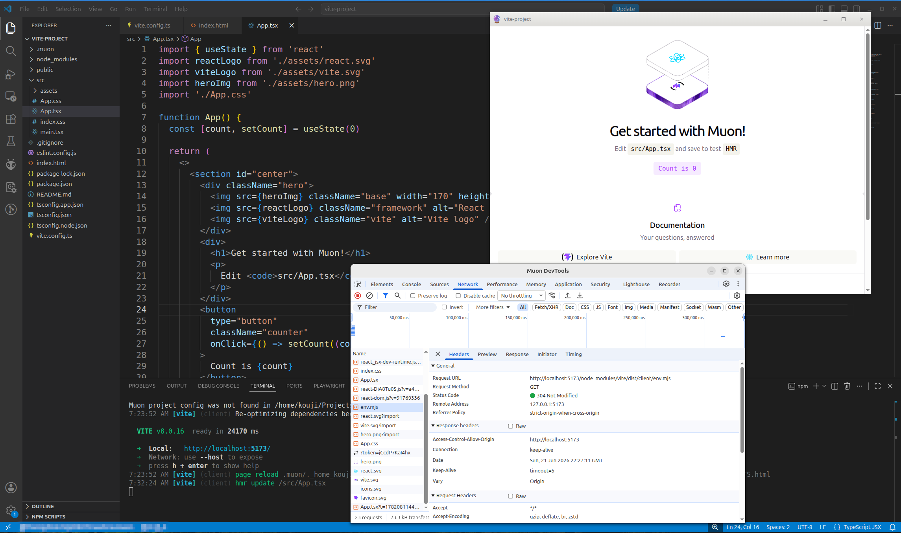
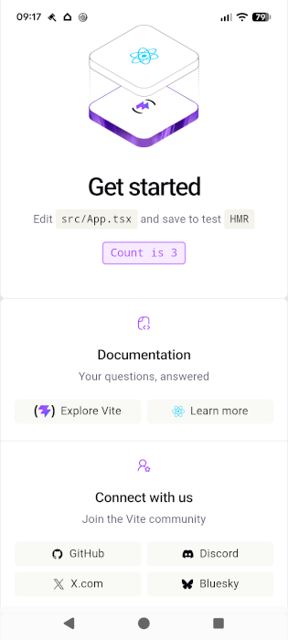
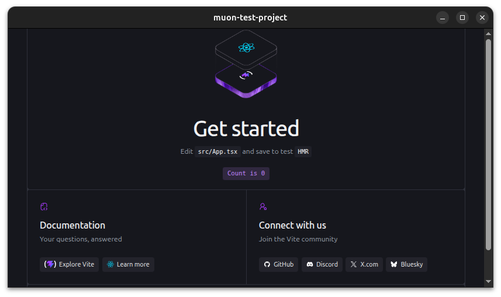
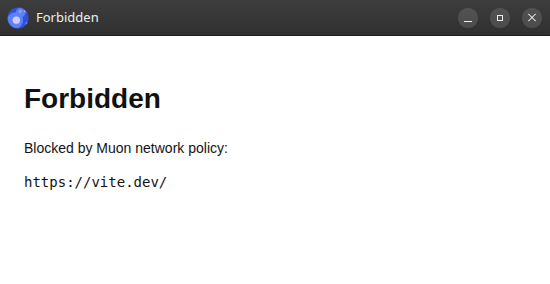
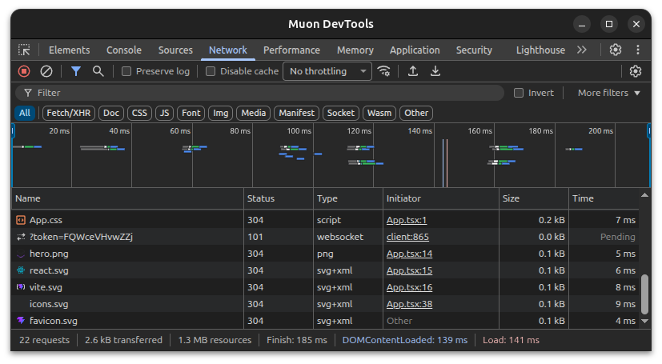

# muon

ウェブ技術でGUIアプリケーションを開発するためのマルチプラットフォーム基盤


[](https://www.repostatus.org/#wip)
[](https://opensource.org/licenses/MIT)
[](https://www.npmjs.com/package/muon-ui)

---

[(English language is here)](./README.md)

## これは何?

あなたは、古くなってしまったネイティブGUIアプリケーションを、どうにかして最新のモダン化されたアプリケーションに更新したいと考えたことはありますか？
アプリケーションのリプレースメントは非常に複雑で、私達をいつも悩ませて来ました。

その原因は多岐に渡るため、「この手法を使えば簡単に解決する！」というような、魔法のソリューションは存在しません。
それでもなお、できるだけ低いコストで現代的に刷新したいとは、誰しもが考えることでしょう。

muon (ミューオン, /ˈmjuːɒn/) は、Linux・WindowsではCEF (Chromium Embedded Framework)、AndroidではWebViewを使うマルチプラットフォームGUIアプリケーション基盤です。
あなたは恐らく、 [Electron](https://www.electronjs.org/) に代表される同種のプロジェクトをいくつか聞いたことがあるかもしれません。
 
乱暴に言えば、muonはそれらと同じポジションの基盤ソフトウェアです。
つまり、ローカルで動作するGUIアプリケーションを、ウェブアプリケーションとして実装出来るソフトウェアです。

muonを使用すれば、最も発達し、かつ最も使われているブラウザ環境のUIフレームワーク、例えばReactやVueを使用して、
ネイティブアプリケーションを作ることが出来ます。



では、muonは先発の基盤ソフトウェアとどう違うのでしょうか？

muonはローカル環境でのGUIアプリケーション開発に特化しています。
デスクトップ版では、外部のウェブリソースへのアクセスをホワイトリストで制限します。

CEFを使うのに、世界中のウェブサイトにアクセス出来ないのはもったいない！ と思うかもしれません。
ですが、既存のソリューションが非常に複雑で扱いづらくなっている最大の問題点はそこにあると考えています。

> Android版のWebViewの外部通信は、Androidの権限とネットワークセキュリティ設定に従います。[Android版の制約](./docs/ja/limitation.md#android-webviewバックエンド)

そして、ネイティブライブラリとの相互運用を実現する、完全に非同期処理に対応したプラグインシステムも搭載しています。
これらも事前構成に基づいて使用可能になるため、使われない機能を野放しにすることはありません。

WebGL、WebGPU、WebAssembly、Web Workers、ローカルストレージなどの対応範囲は、各環境のCEFやWebViewのバージョンと設定によって異なります。
デスクトップ版ではDevToolsを表示できます。CDP (Chrome DevTools Protocol) も使用できるため、vscodeなどでデバッグしたり、Playwrightを接続して操ることも可能です。
Chromium/Chromeから、 `chrome://inspect/` でリモートDevToolsを使用することも可能です。

つまり、GTK/Qt/Windowsなどのネイティブアプリケーションをウェブアプリケーションに移行する際に発生する、大きな問題点の一つをわかりやすく除外することで、
ウェブベース技術のエコシステムを使って現代的なローカルGUIアプリケーションを開発出来ます。

更に、muonでアプリケーションを作る時のステップを最小化して、muonアプリを作る障壁を低く抑えています。
デスクトップ版の最小構成なら、NPMパッケージを導入して構成ファイルに1行加えるだけで、最初のmuonアプリが動き出します。

Linux、Windows、そしてAndroidにも展開できます。



> 注意: AndroidビルドはまだExperimentalですが、完成に向けて作業しています。

Linuxにはdeb、AppImageパッケージまたはtarball、WindowsにはNullSoft Installer(NSIS)によるインストーラーまたはzipファイルを出力できます。

### 特徴

- デスクトップ版では、外部のウェブリソースへのアクセスをホワイトリストで制限できます。
- 扱いやすいNPMパッケージとして提供され、あなたのウェブアプリケーションプロジェクトを簡単にネイティブGUIアプリケーション化出来ます。複雑な構成や変更は不要です。
- レンダリングにはLinux・WindowsでCEF、AndroidでWebViewを使います。
- Viteプラグインに対応しています。デスクトップ版ではViteのHMRで開発中のプレビューをリアルタイムに更新できます。
- Linux（deb、AppImage）とWindows（NSIS）のパッケージ生成、ポータブル運用に対応しています。
- Androidアプリケーションのビルドも可能です (Experimental)。
- デスクトップ版ではDevToolsを表示でき、CDPを使ったリモートデバッグも可能です。
- プラグインシステムを備えています。また、プラグインの機能は、ホワイトリストフィルターで制限出来ます。
- 独立したSDKでC/C++プラグインを開発し、ビルド済みNPMパッケージとして配布・利用できます。
- 内蔵プラグインでローカルファイルにアクセスできます。デスクトップ版ではファイル選択ダイアログの表示、子プロセスの起動、ウインドウの位置やサイズの変更も可能です。

### 環境

- 対応アーキテクチャ
  - Linux: amd64, armhf, arm64
  - Windows: i686, amd64
  - Android: arm64-v8a, x86_64
- ビルド環境
  - Node.js 20以降
  - Vite 5以降

---

## muonを始める (高速バージョン)

この節はLinux・Windows向けの手順です。
Android向けのSDK・JDKの準備、Vite設定、APKの生成・署名は[Androidアプリのビルド・配布](./docs/ja/android.md)を参照してください。

早速muonでアプリケーション（muonアプリ）を作ってみましょう。
[Viteのテンプレート](https://vite.dev/guide/) を使って、"my-muon-app" を「普通に」作りましょう:

```bash
npm create vite@latest my-muon-app -- --template react-ts
```

ここではReact+TypeScriptを選択しましたが、もちろん他の選択肢でもOKです。TypeScriptは有効化してください。
そして:

```bash
cd my-muon-app
npm install
npm run dev
```

これで、Viteの開発サーバーが起動するので、リンクをクリックしてブラウザでページを表示出来ます。

このプロジェクトにmuonを導入します:

```bash
npm install -D muon-ui
```

CEF本体バイナリは、NPMパッケージに含まれません。CEFは必要になった時点で、公式CDNからダウンロードされます。

その後、Viteにmuon Viteプラグインを追加して、muonビルドできるようにします。 `vite.config.ts` に以下のコードを追加します:

```ts
import { defineConfig } from 'vite'
import react from '@vitejs/plugin-react'
import muon from 'muon-ui/vite'

export default defineConfig({
  plugins: [
    react(),  // Reactプラグイン
    muon(),   // muonプラグイン (追加する)
  ],
})
```

これで準備は完了です。いよいよmuonを起動します:

```bash
npm run dev
```

で、muonのウインドウとViteテンプレートプロジェクトのページが表示されるはずです!



"Explore Vite" のようなボタンをクリックした場合、新たなウインドウが開いて、以下のような「がっかり」するページが表示されます:



そして、これこそが、muonの特徴である、ネットワークアクセスのホワイトリストフィルタが機能している証拠です。別サイトコンテンツへのアクセスが遮断されているのです。

また、`F12` キーでmuon DevToolsを起動出来ます:



CDP (Chrome DevTools Protocol) も有効化されているので、Playwrightで操作したりvscodeでデバッグが可能です（詳しくば別章を参照）。

muonアプリのパッケージ化を行うのも簡単です:

```bash
npx muon pack
```

LinuxとWindowsの配布物を`artifacts/`へ生成します。Linux向けのAppImageは、CPUごとに一つのファイルとして配布できます。作成方法と実行環境は[muon CLI](./docs/ja/muon-cli-advanced-topics.md#appimageの作成と実行)を参照してください。

---

## ドキュメント

muonをより詳しく知りたい場合は、以下のドキュメントを参照してください。

### ユーザーガイド

- [muonを始める](./docs/ja/getting-started.md)
- [Androidアプリのビルド・配布](./docs/ja/android.md)
- [CEFのダウンロードと更新](./docs/ja/cef-download-and-update.md)
- [muon DevTools](./docs/ja/muon-devtools.md)
- [ローカルアセットの構成](./docs/ja/local-assets.md)
- [muonプラグインを使用する](./docs/ja/muon-plugins.md)
- [外部ネットワークにアクセスする](./docs/ja/external-network.md)

### Advanced topics

- [muon CLI](./docs/ja/muon-cli-advanced-topics.md)
- [パッケージのインストール先について](./docs/ja/package-install-location-advanced-topics.md)
- [CEFバージョンとCEF APIバージョン](./docs/ja/cef-version-and-cef-api-version-advanced-topics.md)
- [CEFバイナリ更新の詳細](./docs/ja/cef-binary-update-details-advanced-topics.md)
- [ウインドウ間連携の制約](./docs/ja/window-communication-limitations-advanced-topics.md)
- [ローカルアセットの権限](./docs/ja/local-asset-permissions-advanced-topics.md)
- [ローカルアセットのパッキング](./docs/ja/local-asset-packing-advanced-topics.md)
- [オリジンベースのアクセス許可](./docs/ja/origin-based-permissions-advanced-topics.md)

### リファレンス

- [muon.jsonリファレンス](./docs/ja/muon-json-reference.md)
- [muon Viteプラグインリファレンス](./docs/ja/muon-vite-plugin-reference.md)
- [muon内蔵プラグインリファレンス](./docs/ja/muon-built-in-plugin-reference.md)

### muonプラグインの実装

- [muonプラグイン開発](./docs/ja/muon-plugin-develop.md)
- [独立SDKによる外部プラグイン開発とNPM配布](./docs/ja/muon-plugin-sdk.md)

### その他

- [muon-uiセルフビルド](./docs/ja/muon-ui-self-build-advanced-topic.md)
- [制約](./docs/ja/limitation.md)

---

## ライセンス

Under MIT.
